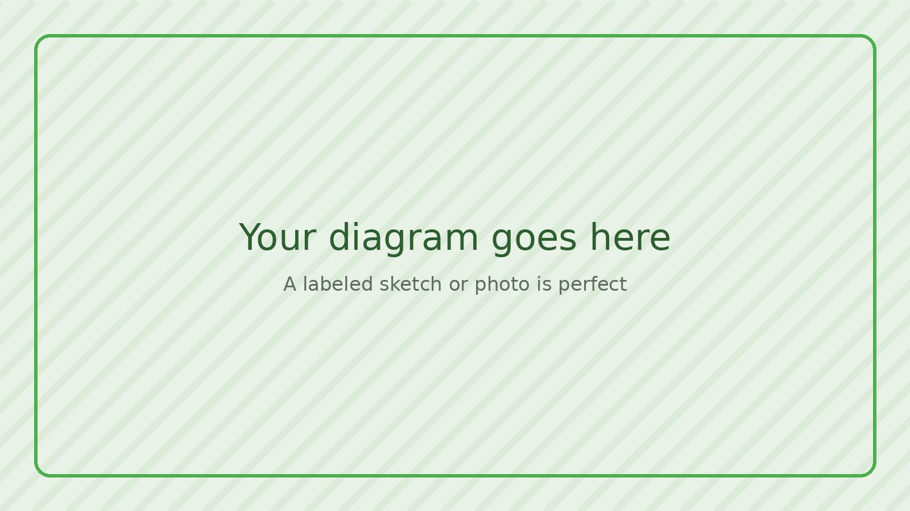

# Anatomy

<!--
Show what it's made of and how the pieces fit together. Any of these work:

- A sketch on paper with the main parts labeled, photographed with your phone
- A photo of the thing with labels added
- A CAD render or exploded view
- A text diagram that draws itself. Write lines like these:

      flowchart LR
        A[Solar panel] --- B[Heater] --- C[(Tank)]

  and wrap them in a code block whose first line is three backticks
  followed by the word mermaid, and whose last line is three backticks.
  (For arrows instead of lines, use two dashes and a greater-than sign.)

Tip: name the main parts in your diagram the same way you name the sections in
your parts list. Then the picture and the list explain each other.
-->

<!-- A sentence or two walking through the main parts, if it helps. -->

## Parts

<!--
This list is built automatically from parts.csv. Edit that file (it opens as
a spreadsheet in Pages CMS), not this page.
-->

{{ parts_list }}

## Files

<!--
Everything in the files folder is listed here automatically: CAD models,
drawings, cut files, code, data. Upload files under Media → Files.
-->

{{ files_list }}

### How It Works:
