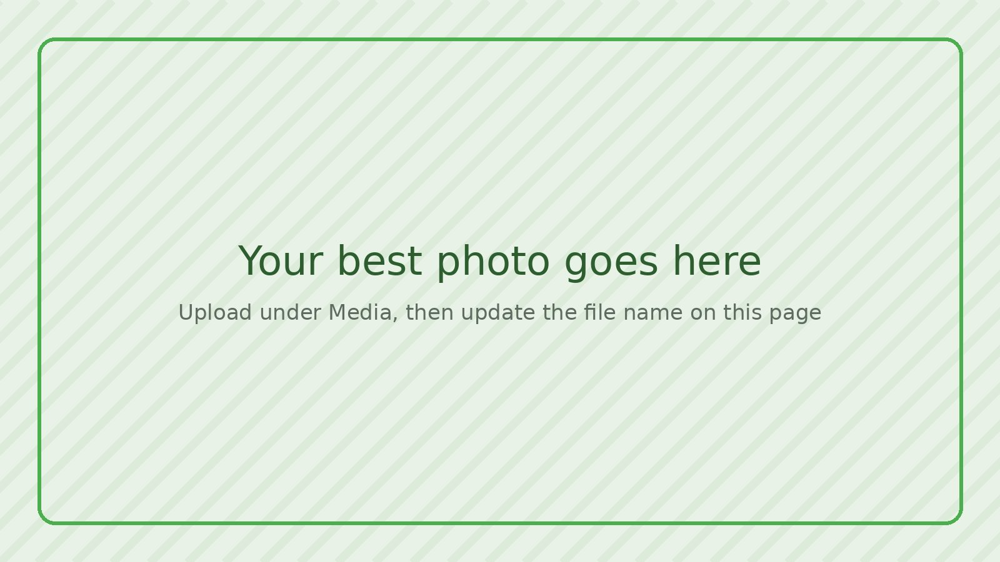

# PROJECT NAME

**Status:** Idea <!-- Pick one: Idea · Prototype · Working · Done · Retired -->

**Maker:** YOUR NAME · Mars College Dept of Makers, 2027

## Documentation

- [How It Works](how-it-works.md)
- [Project Log](log.md)
- [Build It Yourself](build-it.md)

<!--
A few sentences is plenty. Some questions to get you going:

- What is it, in plain words? Imagine telling someone at dinner.
- Who or what is it for?
- Why did you want to make it?

Replace hero.jpg with your best photo. Upload it under Media, then
change the file name in the line above to match.
-->
**Brief Summary:**
Write a few sentences about what you made.

## References:

- previous similar builds, papers, etc.
